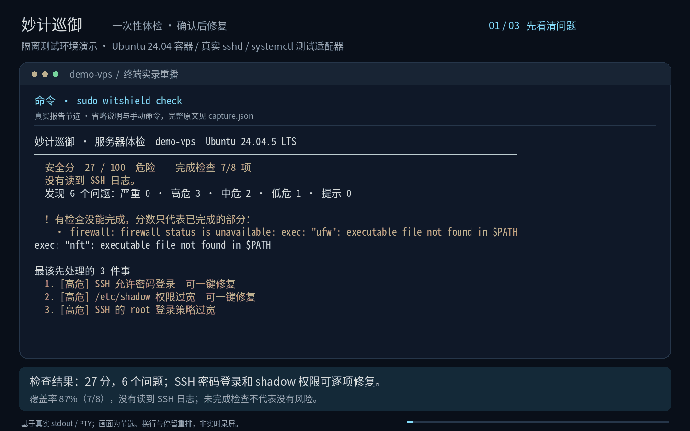

**一条命令，检查服务器常见风险；能自动处理的，先预览，再由你确认。**



```bash
curl -fsSLO https://github.com/witkitlab/witshield/releases/download/v0.4.0/check.sh && less check.sh && sudo bash check.sh --version v0.4.0
curl -fsSL https://github.com/witkitlab/witshield/releases/download/v0.4.0/check.sh | sudo bash -s -- --version v0.4.0
```

**v0.4.0 尚待发布**，以上是计划版本的用法，发布资产就绪后才能运行。第一条先下载并审阅脚本，第二条直接执行远程脚本。`check.sh` 下载程序后会校验 SHA-256 和 GitHub 发布工作流的 Sigstore 签名，任一校验失败都会停止。脚本本身需要你信任下载来源，推荐先审阅。

[产品官网](https://witshield.witkitlab.com) · [English](README.en.md) · [安全模型](docs/threat-model.md) · [参与贡献](CONTRIBUTING.md)

支持 Linux `amd64` / `arm64`，目前以 Ubuntu/Debian 为主要支持范围。无需注册、安装常驻服务或开放管理端口。不用 `sudo` 也能体检；权限不足或数据不可见时，会列出未完成检查，分数只代表已完成的部分。

## 它会检查什么

- **SSH 登录**：是否允许密码登录、是否允许 root 直接登录。
- **特权账号**：是否存在 root 以外的 UID 0 账号。
- **密码文件权限**：普通用户能否读取 `/etc/shadow`。
- **监听端口**：哪些 TCP 服务监听在非回环地址，需要你确认是否应当对外开放。
- **主机防火墙**：主机防火墙是否启用；云安全组仍需你另行检查。
- **内核加固**：地址随机化、链接保护、SYN Cookie、内核日志和指针访问限制。
- **系统更新**：APT 本地包索引中是否有已安装软件包的待更新版本。
- **Docker 接口**：本机 Docker socket 是否对所有用户开放。

报告先展开最该处理的 3 件事，再列出其余问题，并给出原因、证据和手动处理建议。它还会尝试读取最近 24 小时的 SSH 登录失败次数、来源 IP 数和最多 3 个来源；读不到日志时显示“没有读到 SSH 日志”，不会把缺失数据当作 0 次。

安全分用于给这些检查排序，不能证明服务器没有被入侵，也不能替代完整安全审计。即使使用 `sudo`，数据源缺失时也可能只完成部分检查。

下载校验完成后，脚本会在临时目录运行程序并在退出时清理。想复查或修复，可以重新运行已下载的脚本；若使用 Release 中的独立程序，可直接运行：

```bash
witshield check
sudo witshield check --fix
witshield check --json
witshield version
```

`check` 的退出码为安全分 ≥ 60 时 `0`、低于 60 时 `1`、用法或运行错误时 `2`。分数可能只有部分覆盖，脚本仍应同时检查 JSON 中的 `summary`。修复后请重新体检，查看新的分数。

## 为什么敢让它修

`--fix` 需要 root 权限，每项先做预检和预览，输入 `y` 后才执行，改完再验证。CLI 只调用现有的强类型修复流程，不执行模型返回的命令。

第一期只自动处理 3 类问题：

| 问题 | 会做什么 | 保护与限制 |
|---|---|---|
| SSH 允许密码登录 | 关闭 `PasswordAuthentication` | 找不到公钥就拒绝；先校验 SSH 配置，再重新加载服务。保持当前窗口，用第二个窗口验证密钥登录，再确认保留；默认 180 秒未确认会尝试恢复配置。 |
| `/etc/shadow` 权限过宽 | 修为 `root:shadow 0640`；系统没有 shadow 组时用 `root:root 0600` | 只处理这一个文件，权限和属主受白名单限制；失败时按流程尝试恢复。 |
| 系统软件包待更新 | 一次最多升级 64 个明确列出的已安装软件包 | 不新增或删除包；在 APT 锁内校验整个事务，拒绝未授权的依赖变化，记录并核对版本。升级及恢复可能失败，先做快照或备份。 |

防火墙、内核参数、Docker 接口、root 登录等问题目前只提供手动建议。执行建议前，请先确认它适合你的服务、SSH 端口和云安全组配置。

恢复不是整机快照。软件包维护脚本、数据库迁移、服务重启等副作用无法保证自动撤销；状态不确定或恢复失败时，需要你人工接管。修复前请阅读[安全模型](docs/threat-model.md)，保留独立备份和云厂商带外控制台。

## 用自己的 AI 解读

AI 是可选项，用你自己的 API，不配置也能体检和交互式修复。以下密钥均为占位符，请在服务器上通过你信任的方式设置自己的密钥，避免把真实密钥写入共享终端记录或提交到仓库。

DeepSeek 示例：

```bash
export WITSHIELD_AI_BASE_URL=https://api.deepseek.com/v1
export WITSHIELD_AI_API_KEY=your-api-key
export WITSHIELD_AI_MODEL=deepseek-chat
export WITSHIELD_AI_PROTOCOL=openai_chat
witshield check --ai
```

通义千问示例，地域和模型以你的控制台为准：

```bash
export WITSHIELD_AI_BASE_URL=https://dashscope.aliyuncs.com/compatible-mode/v1
export WITSHIELD_AI_API_KEY=your-api-key
export WITSHIELD_AI_MODEL=qwen-plus
export WITSHIELD_AI_PROTOCOL=openai_chat
witshield check --ai
```

豆包示例，使用你开通的模型或推理接入点 ID：

```bash
export WITSHIELD_AI_BASE_URL=https://ark.cn-beijing.volces.com/api/v3
export WITSHIELD_AI_API_KEY=your-api-key
export WITSHIELD_AI_MODEL=your-model-or-endpoint-id
export WITSHIELD_AI_PROTOCOL=openai_chat
witshield check --ai
```

这些是兼容接口的配置示例，不代表每个地域、模型和供应商实现均已实测。默认协议为 `openai_chat`，也支持 `openai_responses` 和 `anthropic_messages`；详见 [AI 提供方配置](docs/ai-providers.md)。

`--ai` 会把安全分、已完成与总检查数、问题等级和中文标题，以及 SSH 登录失败次数和来源数量发送给你配置的上游；读不到 SSH 日志时会说明次数未知。不会发送 IP 地址、证据原文、主机名、日志或文件内容。使用前请确认上游的数据保留政策。模型回答只用于展示，不能触发修复。示例使用已下载的独立程序，不需要向 root 环境传递 API Key。

## 常见问题

### 会不会把我锁在服务器外面？

有保护措施，但不能保证零风险。公钥文件存在不代表你的电脑一定能用它登录。关闭 SSH 密码登录前，先亲自验证密钥登录，并保留当前连接和带外控制台。

修改后必须从第二个窗口验证新连接，再回到原窗口确认；默认等待 180 秒，可用 `--ssh-confirm-seconds` 调整到 30–600 秒。超时、拒绝确认或等待期间按 Ctrl-C 时会尝试恢复原配置。若进程被 `kill -9` 或机器重启打断，不能依赖已退出进程继续计时；恢复记录保存在 `/var/lib/witshield-cli/ssh-rollbacks`，下次以 root 运行任意 `witshield` 子命令时会先尝试恢复。无法重新登录时，请通过带外控制台处理。

### 要装服务吗？会改配置吗？

一次性体检不安装服务、不开管理端口，也不修改安全配置。`check.sh` 会联网下载并校验程序；纯体检在本机读取数据，`--ai` 会调用你配置的上游，软件包升级会访问软件源。`--fix` 会修改你逐项确认的内容，并在 `/var/lib/witshield-cli` 保存独立的修复状态。

其他 Linux 发行版可以尝试只读体检，但可能缺少数据源；`--fix` 只支持 Debian 系。检测到已启用的完整版 Helper 时，CLI 会建议在控制台操作，并再次询问是否继续。

### 数据会上传吗？

普通体检没有遥测，也不上传报告。只有显式加上 `--ai` 并配置自己的 API 时，才会发送上面列出的简短上下文。`--json` 输出留在本机，后续如何保存或转发由你决定。

### 和宝塔、1Panel、fail2ban 是什么关系？

宝塔、1Panel 用来管理网站和服务，巡御的一次性体检帮助你检查服务器常见风险，可以配合使用。`check` 不常驻监控或自动封禁来源，不能替代 fail2ban。完整版的持续观察与实验性自动防御需要单独部署和授权，见[进阶说明](docs/advanced.md)。

### 国内下载怎么用？

计划提供 Gitee 镜像。目前仍待创建镜像仓库、配置发布凭据并完成国内服务器实测，以下命令在镜像资产就绪后才可使用，不代表已经验证可用：

```bash
curl -fsSL https://gitee.com/witkitlab/witshield/releases/download/v0.4.0/check.sh | sudo bash -s -- --version v0.4.0 --mirror gitee
```

镜像中的程序仍须通过 SHA-256 和 GitHub 发布工作流身份的 Sigstore 验证。Gitee 附件可能有登录或频率限制；国内下载速度和验签耗时尚待实测。

## 进阶：多台服务器持续守护

需要常驻巡检、自建控制台、多机管理、通知或按策略自动响应时，阅读[完整版部署与安全说明](docs/advanced.md)，以及[架构](docs/architecture.md)、[安全模型](docs/threat-model.md)和[运维手册](docs/operations.md)。

## 路线图

下一阶段计划通过 MCP / Skill，让 Claude Code、Codex 等 AI Agent 在巡御现有的授权和强类型动作边界内管理服务器；这些接口尚未提供。宝塔、1Panel 集成也属于后续计划。

贡献前请阅读 [CONTRIBUTING.md](CONTRIBUTING.md)。安全问题按 [SECURITY.md](SECURITY.md) 私下报告。项目采用 [Apache License 2.0](LICENSE)。
